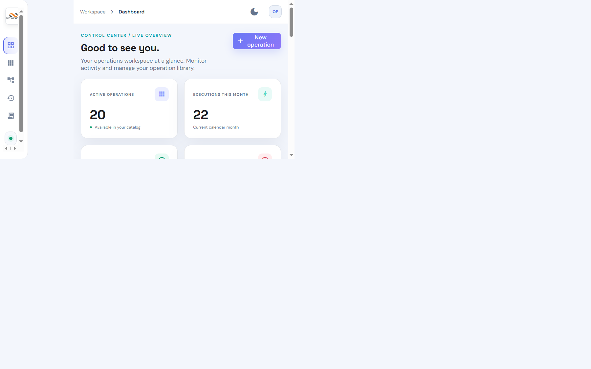
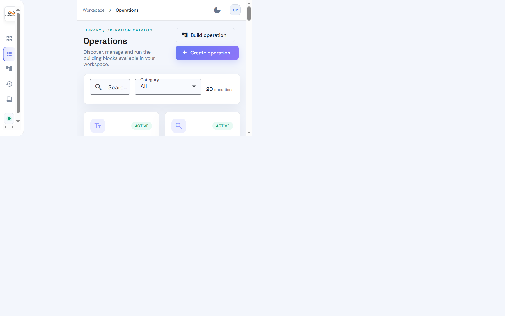
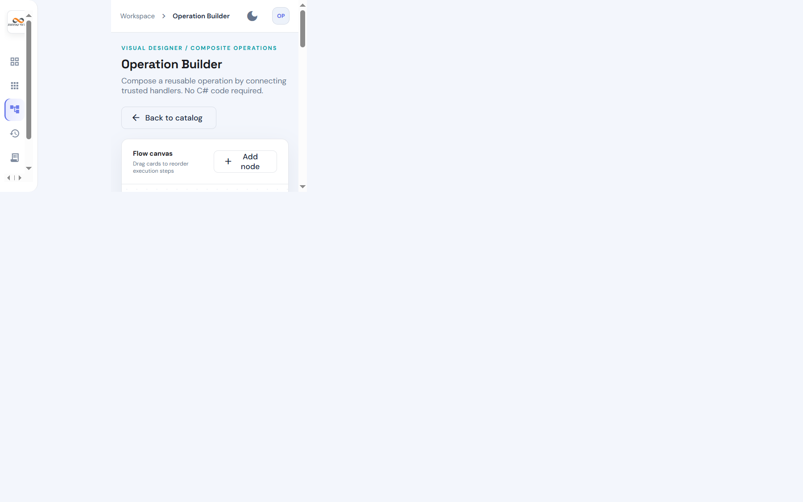

# Operations Hub

Operations Hub is a server-side operations platform for creating, managing, executing, and composing reusable operations.

## Overview

Operations Hub combines built-in functions, custom C# code, REST APIs, and visual operation flows in one workspace.

### Capabilities

- **Operation catalog** with search, categories, create/edit, run, and soft-delete actions.
- **Custom C# operations** compiled and executed through a separate worker process.
- **REST API operations** with methods, headers, query parameters, authentication, timeout, and JSON/text responses.
- **Operation Builder** that chains existing operations and passes outputs to the next node.
- **Execution history** with inputs, output, status, duration, and trace data.
- **SQL application logs** and live dashboard metrics.
- **Light and dark themes**.







## Installation

### 1. Prerequisites

| Technology | Supported version |
|---|---|
| .NET SDK | 8.0.x |
| SQL Server | SQL Server 2017 or newer |
| Node.js | 22.22.3, 24.15.0, or 26.x |
| npm | 10.9.0 or newer |
| Angular | 22.2.7 |
| TypeScript | 6.0.x |
| Entity Framework Core | 8.0.34 |

SQL Server with Windows authentication or SQL authentication is supported. SQL Server Express/Developer Edition can be used locally.

### 2. Clone the repository

```powershell
git clone https://github.com/orisimh/OperationsPlatform.git
cd OperationsPlatform
```

### 3. Configure SQL Server

Open `Backend/OperationsPlatform.Api/appsettings.json` and update `ConnectionStrings:DefaultConnection`.

Windows authentication:

```json
"ConnectionStrings": {
  "DefaultConnection": "Server=localhost;Database=OperationsPlatformDb;Trusted_Connection=True;MultipleActiveResultSets=True;Encrypt=True;TrustServerCertificate=True;"
}
```

Named instance example:

```text
Server=localhost\SQLEXPRESS;Database=OperationsPlatformDb;Trusted_Connection=True;MultipleActiveResultSets=True;Encrypt=True;TrustServerCertificate=True;
```

SQL authentication example:

```text
Server=localhost;Database=OperationsPlatformDb;User Id=YOUR_USER;Password=YOUR_PASSWORD;Encrypt=True;TrustServerCertificate=True;MultipleActiveResultSets=True;
```

Do not commit real credentials. On the first API startup, Entity Framework creates the database and seed operations automatically.

### 4. Start the backend

Run from the repository root:

```powershell
.\scripts\start-backend.ps1
```

Or run manually:

```powershell
dotnet restore .\OperationsPlatform.sln
dotnet build .\OperationsPlatform.sln
dotnet run --project .\Backend\OperationsPlatform.Api\OperationsPlatform.Api.csproj
```

The API starts at `http://localhost:5080`:

- Health: `http://localhost:5080/health`
- Swagger: `http://localhost:5080/swagger`

### 5. Start the frontend

```powershell
cd .\Frontend
npm install
npm start
```

Open `http://localhost:4200`.

The frontend API address is configured in `Frontend/src/environments/environment.ts`:

```ts
apiBaseUrl: 'http://localhost:5080/api'
```

If the frontend or API uses a different port, update `Frontend:AllowedOrigins` and `apiBaseUrl` accordingly.

## Technology Stack

| Area | Technology |
|---|---|
| Frontend | Angular 22.2.7, Angular Material 22.2.7, RxJS 7.8.2, TypeScript 6.0 |
| Backend | ASP.NET Core 8.0, C# / .NET 8 |
| Database | SQL Server 2017+ with Entity Framework Core 8.0.34 |
| REST Integration | ASP.NET Core `HttpClient` |
| Custom Code | Separate C# worker compiled with Roslyn |
| API Documentation | Swagger / OpenAPI |

## Useful Commands

```powershell
# Backend and C# worker
.\scripts\start-backend.ps1

# Angular frontend
.\scripts\start-frontend.ps1

# Frontend development build
cd .\Frontend
npm run build:dev

# Backend solution build
cd ..
dotnet build .\OperationsPlatform.sln
```
